# End-to-End Automated Incident Response Lab: Active Directory, Splunk SIEM & Shuffle SOAR (with Custom Python/LDAP Middleware)

## 1. Project Overview & Objective
The primary objective of this project is to design, deploy, and engineer an end-to-end **Automated Incident Response (IR) and Threat Containment pipeline**. This implementation detects unauthorized Remote Desktop Protocol (RDP) authentications via **Splunk Enterprise (SIEM)**, orchestrates real-time alerting via **Slack** and **Email** using **Shuffle (SOAR)**, and executes automated threat containment—specifically disabling the compromised domain user account on an **Active Directory Domain Controller**—following a **Human-in-the-Loop (HITL)** analyst approval process.

### Architectural Shift: Cloud vs. On-Premises Virtualization
Despite the option to leverage cloud-based VMs with exposed public IP addresses and cloud firewall groups, I engineered this environment **entirely locally using Oracle VirtualBox**.

* **Why Local Virtualization?**

  1. **Zero Cost & Resource Optimization:** Avoided cloud billing while optimizing resource allocation (vCPUs/RAM) on the host machine.
  2. **Network Isolation & Security:** Simulated an enterprise internal network (`10.22.96.0/24`) isolated behind a VirtualBox NAT Network, preventing accidental exposure of vulnerable services (such as unencrypted LDAP or RDP with weak credentials) to the public internet.
  3. **Real-World Hybrid Engineering:** Connecting a cloud-based SOAR platform (Shuffle SaaS) to an isolated, on-premise Active Directory environment forced the resolution of real-world networking, tunneling, and cryptographic challenges (such as OpenSSL 3.0 MD4/NTLM deprecation), which were ultimately solved by developing a **custom Python Flask & `ldap3` webhook middleware**.

---

## 2. Lab Architecture & Network Topology

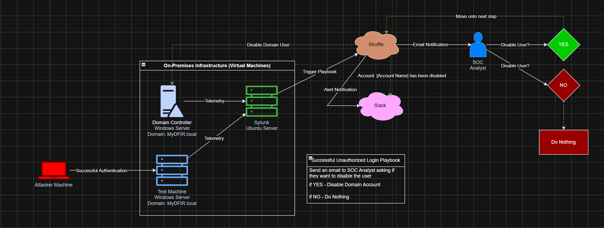

To maintain parity with the private IP addressing scheme of the reference architecture (`10.22.96.0/24`) while eliminating public IP dependencies, a dedicated VirtualBox **NAT Network** named `SOC_AD-Lab` was created with DHCP enabled.

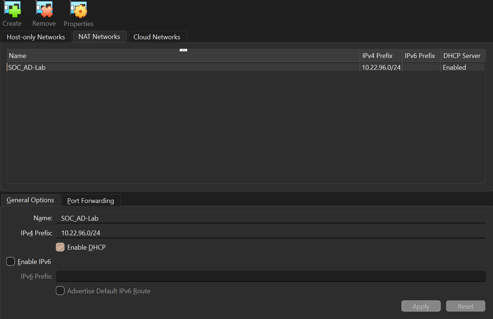

### Virtual Machine Inventory
| Machine Role | Hostname | OS / Platform | IP Address | Allocated Resources |
| :--- | :--- | :--- | :--- | :--- |
| **Domain Controller** | `ADDC01` | Windows Server 2022 (GUI) | `10.22.96.4` | 2 vCPUs, 4 GB RAM |
| **Target Endpoint** | `TestMachine` | Windows Server 2022 (GUI) | `10.22.96.3` | 2 vCPUs, 4 GB RAM |
| **SIEM Server** | `SplunkServer` | Ubuntu Server 22.04 LTS (CLI) | `10.22.96.5` | 2 vCPUs, 4 GB RAM |
| **Attacker & Middleware** | `kali` | Kali Linux | `10.22.96.6` | 2 vCPUs, 4 GB RAM |

---

## ⚙️ 3. Infrastructure Deployment & Attack Surface Configuration

### 3.1 Ubuntu Server Network Configuration (Splunk Host)
Because Ubuntu Server 22.04 was deployed without a GUI to conserve system resources, network configuration was performed via the command line using `netplan` (`/etc/netplan/00-installer-config.yaml`), assigning the static IP `10.22.96.5/24` on interface `enp0s3` and enabling OpenSSH for remote management.

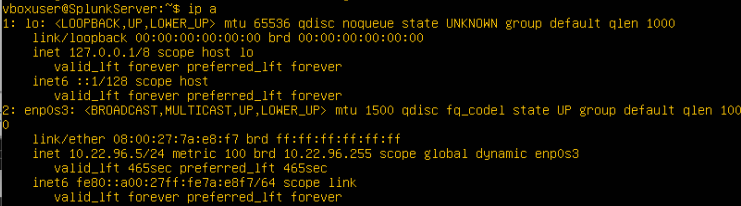

### 3.2 Active Directory Domain Services (AD DS) Deployment
On the first Windows Server 2022 machine (`10.22.96.4`), the hostname was set to `ADDC01`, the **Active Directory Domain Services** role was installed, and the server was promoted to a Domain Controller for a new forest named `MyDFIR.local`[cite: 1, 15].

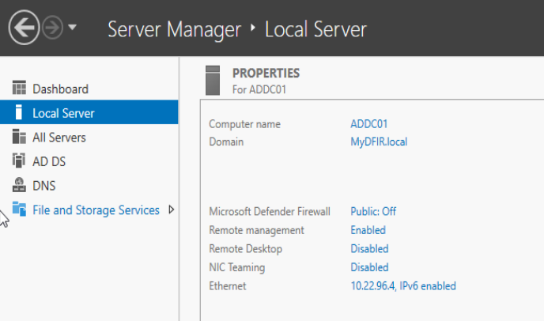

### 3.3 Endpoint Domain Join & Target User Setup
The second Windows Server (`10.22.96.3`) was configured to use `10.22.96.4` (the Domain Controller) as its preferred DNS server, renamed to `TestMachine`, and successfully joined to the `MyDFIR.local` domain[cite: 16].

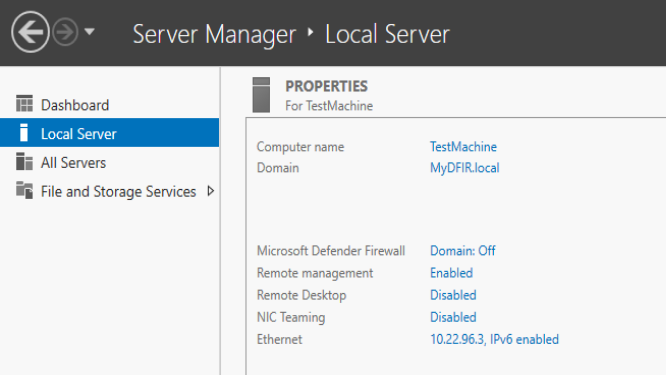

To simulate a standard corporate employee account that could be targeted by an attacker, a domain user named **Jenny Smith (`JSmith`)** was created inside Active Directory Users and Computers[cite: 41]. 

To intentionally expose the attack surface on `TestMachine`, Remote Desktop (RDP) was enabled, and `MYDFIR\JSmith` was explicitly added to the **Remote Desktop Users** group[cite: 17].

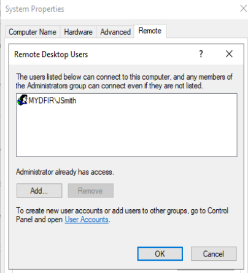

---

## 📊 4. SIEM Deployment & Telemetry Ingestion (Splunk Enterprise)

### 4.1 Installing Splunk Enterprise on Ubuntu Server
Using the `wget` command-line utility, the Splunk Enterprise `.deb` package (`splunk-10.6.1.1-b2ae2962645c-linux-amd64.deb`) was downloaded directly to the Ubuntu Server and unpacked using `dpkg -i`[cite: 18, 19].

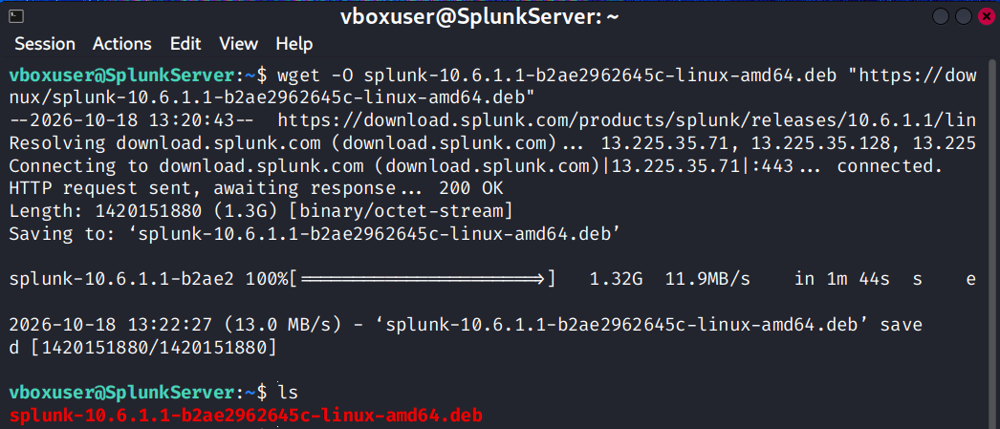

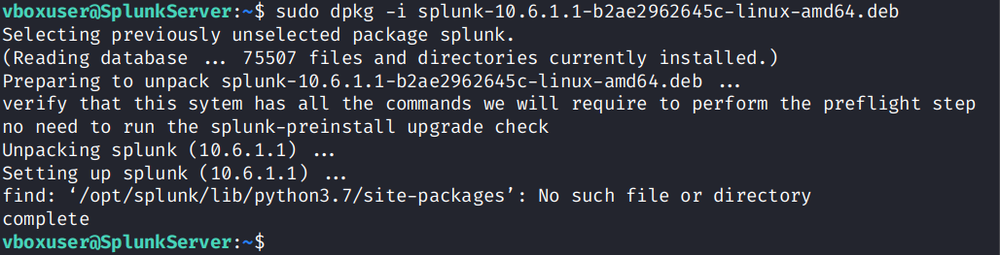

* **🔧 Obstacle #1 — License File Permission Error:**
  * **What went wrong:** When attempting to start Splunk for the first time (`/opt/splunk/bin/splunk start`) and accepting the license agreement, the initialization failed with `Warning: cannot create "/opt/splunk/etc/licenses/download-trial"`.
  * **Why it happened:** The user account running the binary lacked write permissions inside `/opt/splunk`, which was owned by `root` or the `splunk` service account after package extraction.
  * **How it was fixed:** Ownership of the `/opt/splunk` directory was recursively granted to the current administrative user via `sudo chown -R $USER:$USER /opt/splunk`, followed by `./splunk start --accept-license`, allowing clean initialization.

Next, the host firewall (`ufw`) on the Ubuntu server was updated to allow incoming connections on **Port 8000** (Splunk Web GUI) and **Port 9997** (Splunk Universal Forwarder data ingestion)[cite: 20].

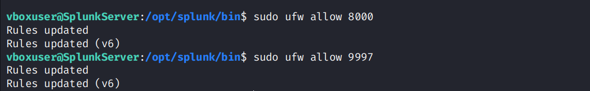

### 4.2 Configuring Splunk Web Interface
Logging into `http://10.22.96.5:8000`, the following foundational configurations were applied:
1. Changed the user timezone preference to **GMT** to ensure normalized timestamp correlation across logs.
2. Installed the **Splunk Add-on for Microsoft Windows**, which provides essential field extractions (such as `user`, `Logon_Type`, and `Source_Network_Address`) for Windows Event Logs.
3. Created a dedicated index named **`mydfir-ad`** to store all Active Directory and endpoint telemetry.
4. Configured a **Receiving Port** on TCP **`9997`** under *Settings -> Forwarding and receiving -> Receive data*[cite: 21].

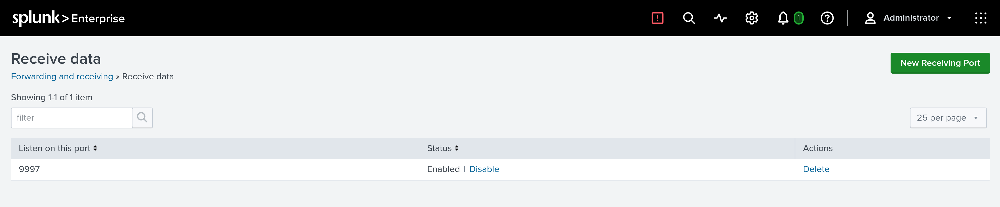

### 4.3 Deploying Splunk Universal Forwarders on Windows Endpoints
The **Splunk Universal Forwarder** was installed on both `TestMachine` (`10.22.96.3`) and `ADDC01` (`10.22.96.4`), pointing to the receiving indexer `10.22.96.5:9997`.

To instruct the forwarder to collect Windows Security Event Logs, the default `inputs.conf` file was copied into `C:\Program Files\SplunkUniversalForwarder\etc\system\local\inputs.conf` and modified (running Notepad as Administrator) by appending the following stanza[cite: 22]:

```ini
[WinEventLog://Security]
index = mydfir-ad
disabled = false
```

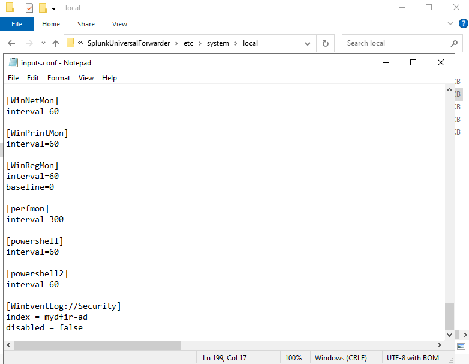

* **Why Service Account Modification Was Required:** By default, the `SplunkForwarder` Windows service may run under a virtual or low-privilege account that lacks permissions to read the protected Windows `Security` event channel. Through `services.msc`, the **SplunkForwarder** service *Log On* property was changed to **Local System account** and the service was restarted[cite: 23].

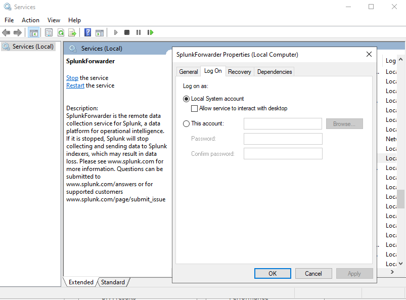

### 4.4 Verifying Telemetry Ingestion
Querying `index="mydfir-ad"` in the Splunk Search & Reporting app immediately returned events from `TestMachine`[cite: 24]. After repeating the exact same Universal Forwarder setup on `ADDC01`, inspecting the `host` field confirmed active telemetry ingestion from **both** `TestMachine` and `ADDC01`[cite: 25].

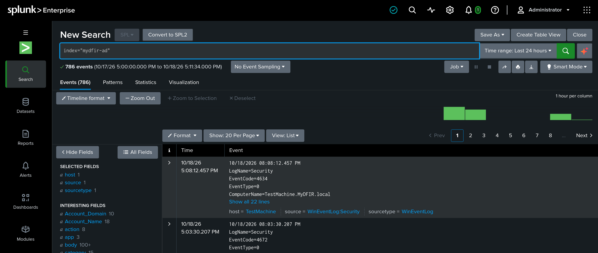

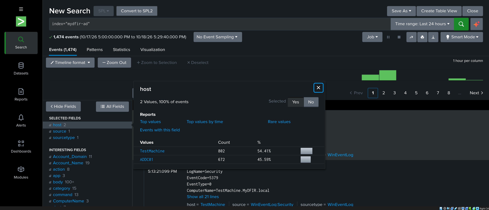

---

## 🎯 5. Attack Simulation & Detection Engineering

### 5.1 Simulating Unauthorized RDP Access from Kali Linux
To generate realistic attack telemetry, I used the Kali Linux machine (`10.22.96.6`) to initiate an RDP session to `TestMachine` (`10.22.96.3`) using the compromised credentials of `JSmith`:

```bash
xfreerdp /u:JSmith /v:10.22.96.3
```

* **🔧 Obstacle #2 — RDP Connection Refused (`ERRCONNECT_CONNECT_FAILED`):**
  * **What went wrong:** The initial connection attempt from Kali failed immediately with `connect to 10.22.96.3:3389 failed with error: Connection refused [111]`[cite: 4].

  * **Why it happened:** Two factors blocked the Linux RDP client: (1) Network Level Authentication (NLA) was enforced on Windows Server, which frequently causes negotiation failures with `xfreerdp` in non-Kerberos/untrusted domain client contexts, and (2) Windows Defender Firewall rules restricted incoming connections on port 3389.
  * **How it was fixed:** On `TestMachine`, under *System Properties -> Remote*, I unchecked **"Allow connections only from computers running Remote Desktop with Network Level Authentication (recommended)"** and disabled the host firewall profiles inside the isolated lab[cite: 26].

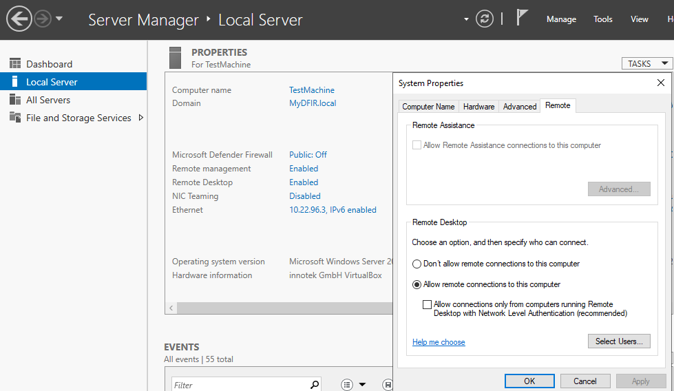

Re-running `xfreerdp /u:JSmith /v:10.22.96.3` from Kali succeeded, opening a full remote desktop session as `MYDFIR\JSmith`[cite: 29].

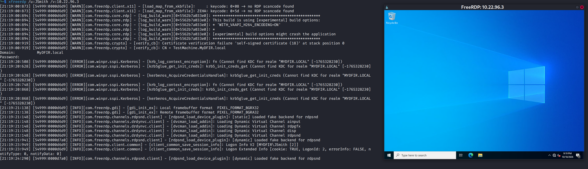

### 5.2 Building the Splunk Detection Query & Alert
In Windows Security Event Logs, **Event ID 4624** denotes a successful account logon, while **Logon Type 7** (Unlock/Reconnect) and **Logon Type 10** (RemoteInteractive / RDP) specifically track Remote Desktop sessions. 

I constructed the following SPL query to isolate the unauthorized RDP login and structure the output into a clean statistical table[cite: 27]:

```spl
index="mydfir-ad" EventCode=4624 (Logon_Type=7 OR Logon_Type=10)
| stats count by _time, host, Source_Network_Address, user, Logon_Type
```

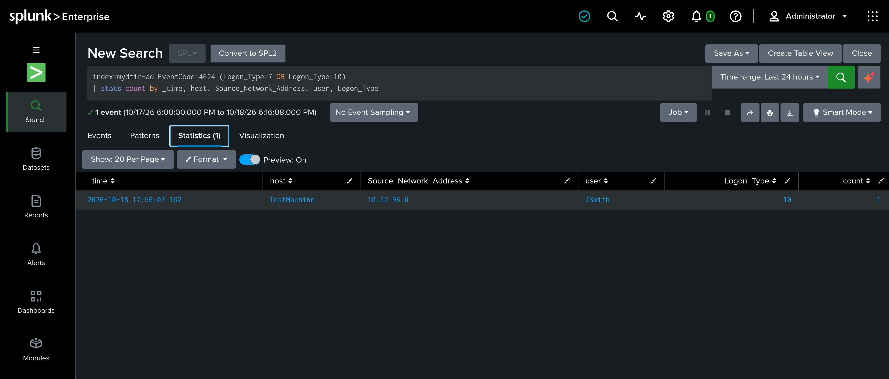

This search was saved as a Scheduled Alert named **`MyDFIR-Unauthorized-Successful-Login-RDP`**, configured with a cron schedule of `* * * * *` (running every minute for lab testing) and set to log to **Triggered Alerts** with **High** severity[cite: 28].

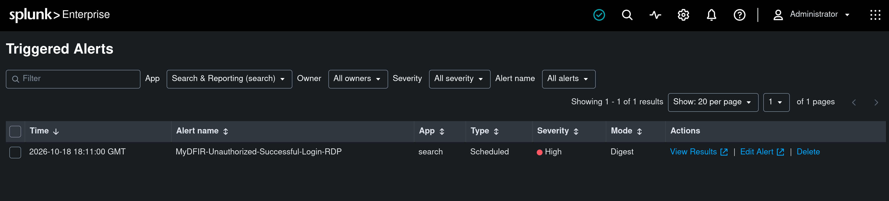

---

## 🤖 6. SOAR Integration: Splunk, Shuffle & Slack

### 6.1 Connecting Splunk to Shuffle via Webhook
Inside **Shuffle SOAR**, I created a workflow named `MyDFIR-AD-Project` and added a **Webhook** trigger named `Splunk-Alert`[cite: 12]. I copied the generated Webhook URI, navigated back to the Splunk Alert settings (*Edit Alert -> Trigger Actions*), added a **Webhook** action, and pasted the Shuffle URI[cite: 34].

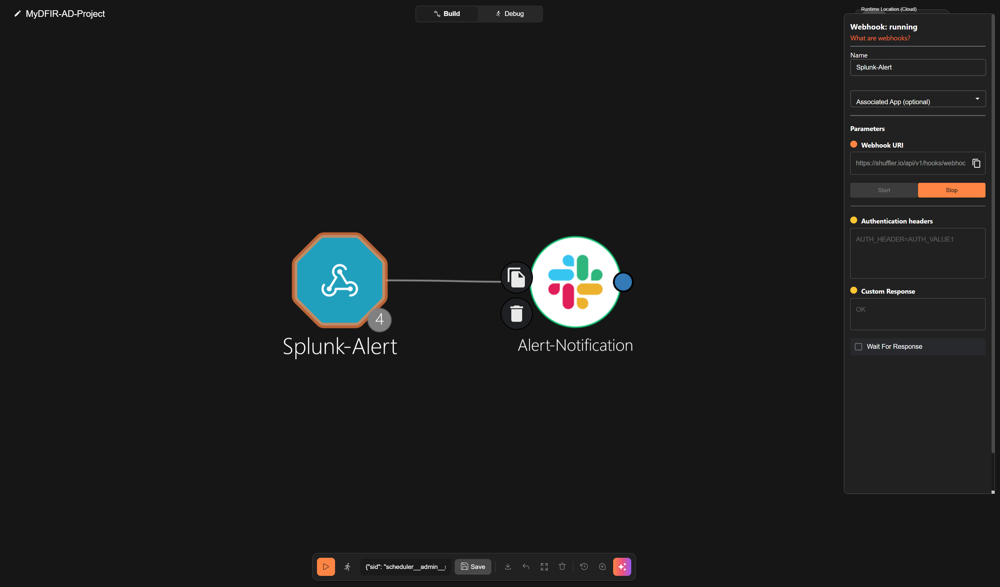

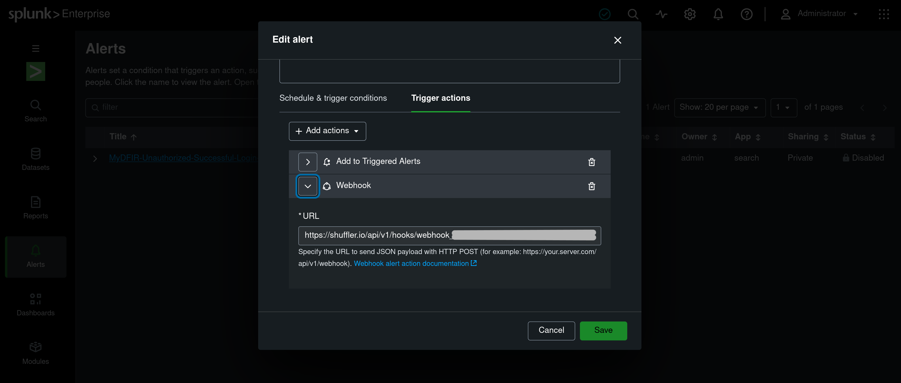

### 6.2 Slack Integration & Troubleshooting
To notify the SOC team in real time, a new Slack workspace (`MyDFIR-Projects`) and a dedicated `#alerts` channel were created[cite: 7]. 

* **🔧 Obstacle #3 — Shuffle "One-Click Login" OAuth Failure:**
  * **What went wrong:** When attempting to authenticate the Slack node in Shuffle using the built-in **"One-click Login"** button, the OAuth flow failed to connect[cite: 5].

  * **Why it happened & How it was fixed (Manual Slack API App Creation):** Instead of relying on the broken pre-configured OAuth wrapper, I navigated to `api.slack.com/apps` and manually engineered a custom Slack Bot App named **`Shuffle-SOC-Bot`**[cite: 31]:
    1. Configured the OAuth Redirect URL to point directly to `https://shuffler.io/set_authentication`[cite: 32].
    2. Assigned the least-privilege Bot Token Scope **`chat:write`**[cite: 32].
    3. Installed the app to the `MyDFIR-Projects` workspace and extracted the **Client ID**, **Client Secret**, and **Bot User OAuth Token (`xoxb-...`)**[cite: 31, 32].
    4. Passed those credentials manually into the Shuffle Slack authentication panel[cite: 30].

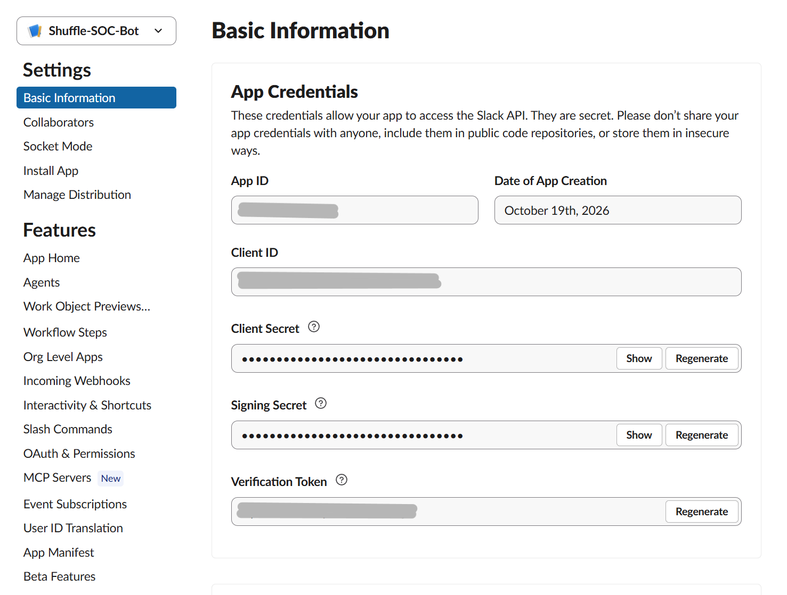

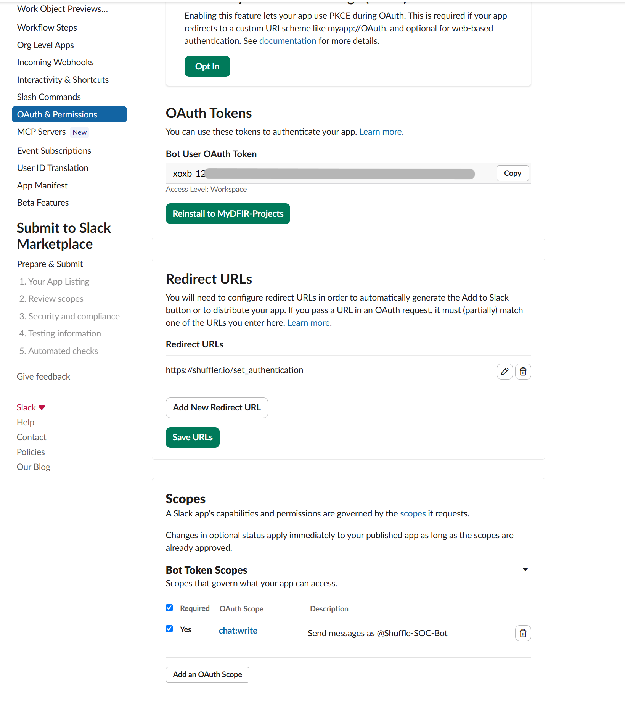

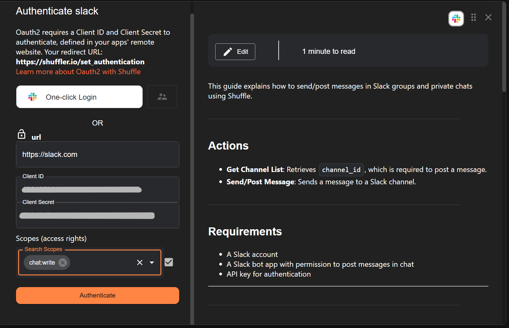

* **🔧 Obstacle #4 — Incorrect Default Action in Shuffle Slack App:**
  * **What went wrong:** After authenticating, the fields `Channel` and `Text` were completely missing from the Slack node configuration panel[cite: 6].
  * **Why it happened:** Due to an update in the Shuffle UI, dragging the Slack app onto the canvas defaulted the selected API action to `GET Get files info` rather than posting a message[cite: 6].

  * **How it was fixed:** I changed the action dropdown to **`chat_postmessage` (Send/Post Message)**, extracted the unique Slack Channel ID (`C0CABR0V0HK`) directly from the browser URL of the `#alerts` channel, and configured the message body using Shuffle runtime variables (`$exec.search_name`, `$exec.result._time`, `$exec.result.user`, `$exec.result.Source_Network_Address`)[cite: 7, 46].

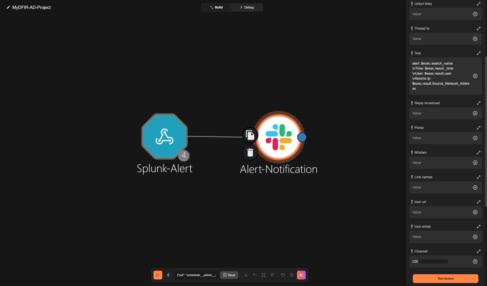

* **🔧 Obstacle #5 — Slack API `"error": "not_in_channel"`:**
  * **What went wrong:** Executing the workflow returned HTTP `status: 200`, yet no message appeared in Slack. Inspecting the JSON execution logs in Shuffle revealed `"ok": false, "error": "not_in_channel"`[cite: 8].

  * **Why it happened:** In Slack's permission model, even a bot with `chat:write` permissions cannot post to a channel unless it has been explicitly invited into that channel.
  * **How it was fixed:** Inside the `#alerts` channel, I executed `/invite @Shuffle-SOC-Bot`. Re-running the workflow immediately delivered the formatted alert to Slack[cite: 33]!

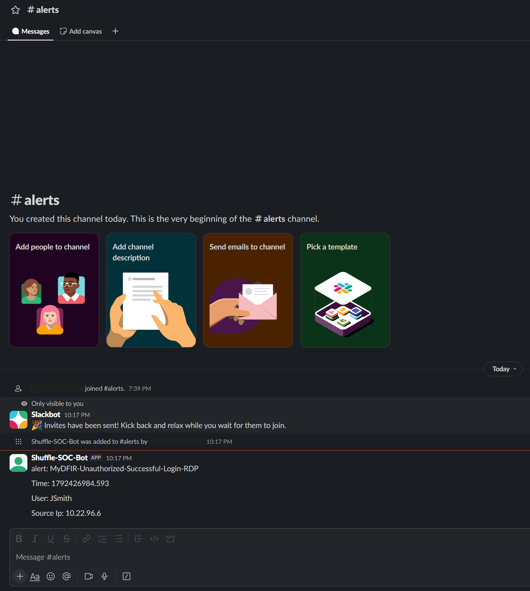

---

## 7. Deep-Dive Troubleshooting: Active Directory Containment & Custom Middleware Engineering

The final phase of the workflow requires sending an email to the SOC Analyst via a **User Input** node (`User Action`), and upon confirmation, disabling the compromised user (`JSmith`) in Active Directory (`ADDC01`), followed by an `Update-Notification` message to Slack[cite: 40, 48].

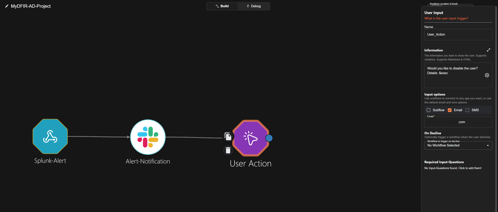

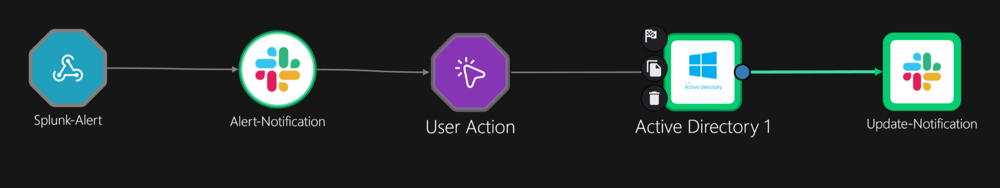

### 7.1 Bridging Cloud SOAR to Local VirtualBox AD (Reverse Tunneling)
Because Shuffle runs in the cloud and `ADDC01` (`10.22.96.4`) resides inside a local VirtualBox NAT Network, Shuffle could not directly reach port `389` (LDAP) on the Domain Controller. Furthermore, `ngrok` now requires a credit card to establish raw TCP tunnels.

* **The Solution (`Pinggy` via Kali Bridge):** Since Kali Linux (`10.22.96.6`) sits on the same `10.22.96.0/24` subnet as `ADDC01`, I used Kali as a network bridge to establish a free, accountless SSH reverse TCP tunnel via `pinggy.io`, forwarding public TCP traffic directly to `10.22.96.4:389`[cite: 37]:

```bash
ssh -p 443 -R0:10.22.96.4:389 tcp@a.pinggy.io
```

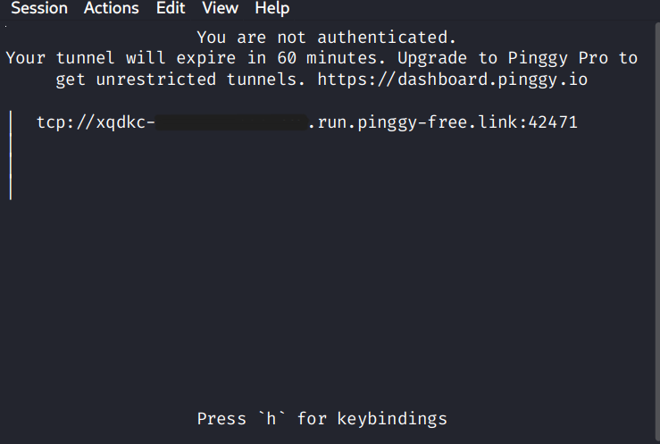

I then configured the native **Active Directory** app in Shuffle with the Pinggy hostname, public port, domain `MyDFIR`, user `Administrator`, and Base DN `CN=Users,DC=MyDFIR,DC=local`[cite: 49].

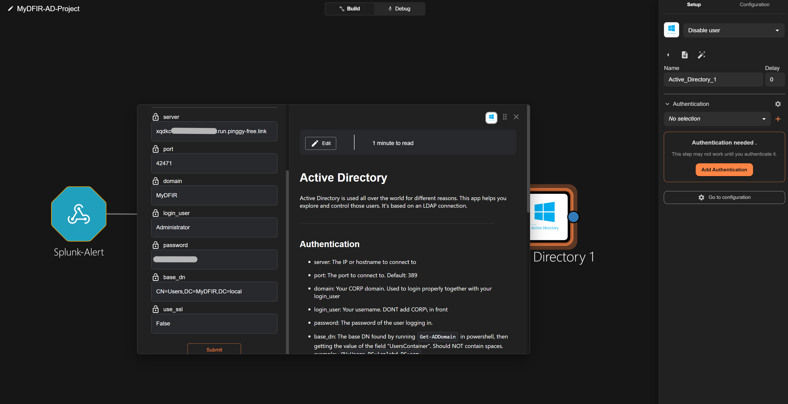

### 7.2 Step-by-Step Diagnosis of the Native AD App Failure (`MD4` / `NTLM`)
When initially testing the native Active Directory node, the workflow failed with a `Timeout error within 30 seconds`. To isolate the root cause, I systematically verified every link in the chain:
1. **Local Port Verification:** Ran `nc -zv 10.22.96.4 389` from Kali -> Confirmed port `389 (ldap) open` on `ADDC01`.
2. **Tunnel Verification:** Ran `nc -zv <pinggy-host> <port>` -> Confirmed the public tunnel was reachable.
3. **LDAP Credentials & Protocol Verification:** Executed an `ldapsearch` query *through the public Pinggy tunnel*:
   ```bash
   ldapsearch -x -H ldap://<pinggy-host>:<port> -D "Administrator@MyDFIR.local" -W -b "DC=MyDFIR,DC=local" "(objectClass=user)" sAMAccountName
   ```
   This succeeded immediately and returned the domain user list, proving 100% that the tunnel, routing, firewall, and credentials were valid.
4. **Capturing Traffic & Identifying the Real Exception:** Re-running the Shuffle workflow showed active packet transfer in the Pinggy terminal (`Recved: 64.00 / Sent: 264.00` —[cite: 11, 38]), and Shuffle returned the true underlying exception[cite: 39]:
   > **`"exception": "ValueError - unsupported hash type MD4"`**

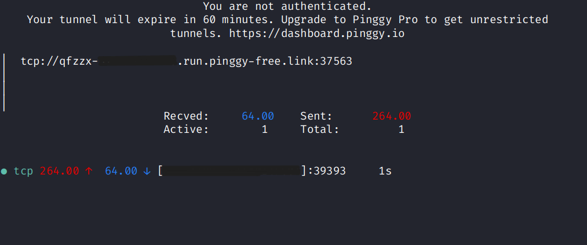

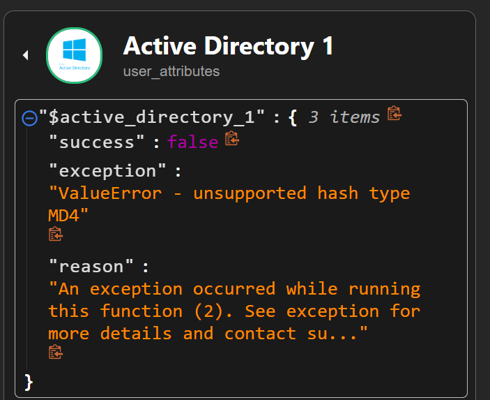

* ** Root Cause Analysis:**
  The native Active Directory app in Shuffle is hardcoded to authenticate via **NTLM**, which cryptographically requires the legacy **MD4** hashing algorithm. However, Shuffle Cloud's underlying container environment runs on modern Linux distributions utilizing **OpenSSL 3.0+**, which disables `MD4` by default at the OS/crypto-provider level. Even when attempting to force Simple Bind by changing the username format, the app enforced NTLM (`NTLM needs domain\username and a password`). Because users do not have root access to Shuffle Cloud's containers to enable legacy OpenSSL providers, **the native AD app in Shuffle Cloud is fundamentally broken for NTLM authentication**.

### 7.3 Exploring Alternative 1: OpenSSH + PowerShell on DC (Abandoned)
I initially considered installing OpenSSH Server on `ADDC01` (`Add-WindowsCapability -Online -Name OpenSSH.Server~~~~0.0.1.0`) and having Shuffle connect via SSH to execute `Disable-ADAccount -Identity JSmith` in PowerShell. However, Shuffle Cloud lacked a straightforward native SSH command-execution app without deploying a local Orborus runner. To keep the Domain Controller clean, OpenSSH was subsequently removed (`Remove-WindowsCapability -Online -Name OpenSSH.Server~~~~0.0.1.0`).

### 7.4 Final Engineered Solution: Custom Python Flask Webhook + `ldap3` Simple Bind
Since `ldapsearch` worked earlier because it uses **LDAP Simple Bind** (which does not rely on MD4/NTLM), I engineered a custom Python microservice (`disable_user.py`) hosted on Kali Linux. 

The service exposes a REST endpoint (`POST /disable`), receives `{"user": "JSmith"}` from Shuffle via an HTTP request, performs an **LDAP Simple Bind** to `ADDC01` (`10.22.96.4:389`) using the `ldap3` library, queries the target user's `userAccountControl` attribute, and performs a bitwise OR with `2` (`uac | 2`, which sets the `ACCOUNTDISABLE` flag).

#### 📄 `scripts/disable_user.py`
```python
import os
from flask import Flask, request, jsonify
from ldap3 import Server, Connection, MODIFY_REPLACE, SIMPLE

app = Flask(__name__)

# Configuration - Uses Environment Variables for Credential Security
DC = os.environ.get("DC_IP", "10.22.96.4")
BIND_USER = os.environ.get("BIND_USER", "Administrator@MyDFIR.local")
BIND_PASS = os.environ.get("BIND_PASS", "<REDACTED_DOMAIN_ADMIN_PASSWORD>")
BASE_DN = os.environ.get("BASE_DN", "DC=MyDFIR,DC=local")

@app.route("/disable", methods=["POST"])
def disable():
    data = request.get_json(force=True)
    user = data.get("user")
    if not user:
        return jsonify(success=False, error="no user"), 400

    # Establish LDAP Simple Bind connection (Bypasses OpenSSL 3 MD4/NTLM restriction)
    conn = Connection(Server(DC, port=389), user=BIND_USER,
                      password=BIND_PASS, authentication=SIMPLE)
    if not conn.bind():
        return jsonify(success=False, error=str(conn.result)), 500

    # Locate target user and retrieve current userAccountControl flags
    conn.search(BASE_DN, f"(sAMAccountName={user})",
                attributes=["userAccountControl"])
    if not conn.entries:
        return jsonify(success=False, error="user not found"), 404

    entry = conn.entries[0]
    uac = int(entry.userAccountControl.value)
    new_uac = uac | 2   # Bit 2 (0x0002) = ADS_UF_ACCOUNTDISABLE
    
    # Apply modification to Active Directory
    conn.modify(entry.entry_dn,
                {"userAccountControl": [(MODIFY_REPLACE, [new_uac])]})
    
    return jsonify(success=conn.result["result"] == 0,
                   user=user, result=conn.result)

if __name__ == "__main__":
    app.run(host="0.0.0.0", port=5000)
```

#### Deploying & Exposing the Custom Webhook:
1. Installed dependencies and started the server on Kali:
   ```bash
   pip install flask ldap3 --break-system-packages
   export BIND_PASS="YourAdminPassword"
   python3 disable_user.py
   ```
2. Verified local functionality using `curl -X POST http://127.0.0.1:5000/disable -H "Content-Type: application/json" -d '{"user":"JSmith"}'` and confirmed on `ADDC01` via PowerShell (`Get-ADUser JSmith -Properties Enabled`) that `Enabled` switched to `False`.
3. Exposed the Flask server (`localhost:5000`) to Shuffle Cloud using an HTTP Pinggy tunnel:
   ```bash
   ssh -p 443 -R0:localhost:5000 a.pinggy.io
   ```
4. Replaced the broken Active Directory node in Shuffle with an **HTTP (`http_1`) POST** node pointing to `https://<pinggy-host>/disable`, passing `{"user": "$exec.result.user"}` in the JSON body[cite: 45].

---

## 8. End-to-End Execution & Final Verification

With the full pipeline assembled (`Splunk-Alert` ➔ `Alert-Notification` ➔ `User Action` ➔ `Http 1` ➔ `Update-Notification`), a new unauthorized RDP login was triggered.

1. **Email Approval Sent to Analyst:** Shuffle paused execution at the `User Action` node (`WAITING` state) and sent an interactive approval email containing the alert telemetry[cite: 44].

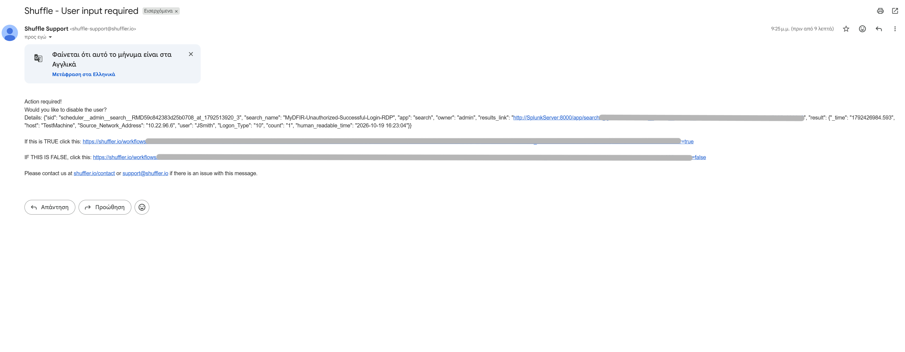

* **🔧 Obstacle #6 — Shuffle Web UI Approval Button Glitch (`api_continue` Workaround):**
  * **What went wrong:** Clicking the confirmation link in the email opened the Shuffle confirmation page[cite: 42], but clicking the **Continue** button in the browser UI threw a `"something went wrong"` platform error.
  * **How it was fixed:** By inspecting the Shuffle execution logs for the `WAITING` workflow run, I extracted the backend `api_continue` webhook URL and triggered the approval directly from Kali via `curl`. The UI updated to *"Question answered. You may close this window."* and the workflow resumed execution immediately[cite: 42]!

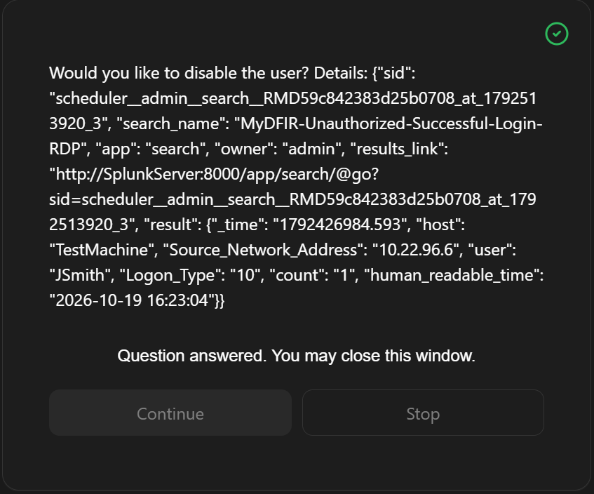

2. **Automated AD Account Disablement via Custom Flask API:** Immediately after approval, Shuffle executed the `Http 1` POST request to the Kali Flask middleware. The execution logs confirmed `status: 200`, `"description": "success"`, `"type": "modifyResponse"`, and `"success": true` for user `"JSmith"`[cite: 45, 47].

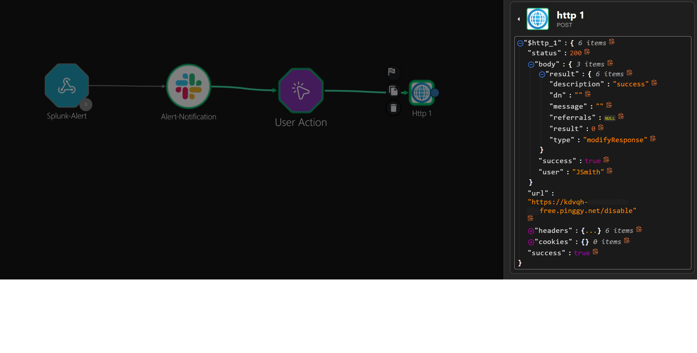

3. **Full Workflow Completion & Slack Confirmation:** Following the successful response from the Flask API, the final `Update-Notification` node fired, posting the confirmation message **`Account: JSmith has been disabled`** into the `#alerts` Slack channel[cite: 43, 47].

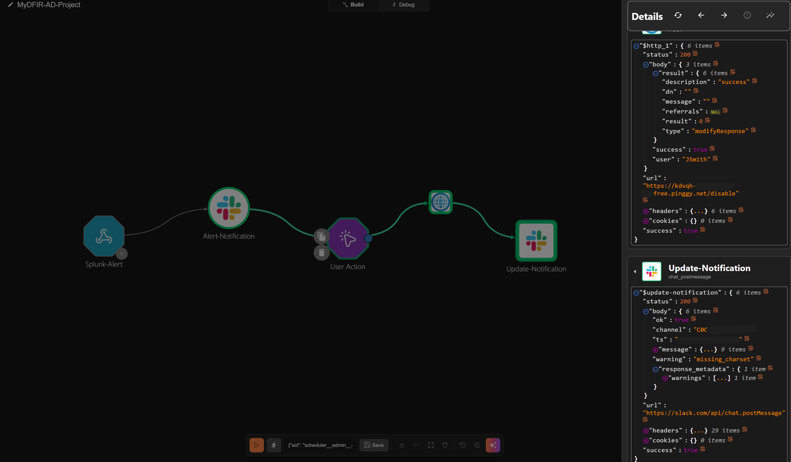

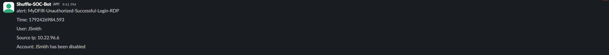

4. **Verification on the Domain Controller:** Refreshing **Active Directory Users and Computers** on `ADDC01` visually confirmed the downward arrow icon next to **Jenny Smith (`JSmith`)**, proving that the compromised domain account was automatically disabled[cite: 41]!

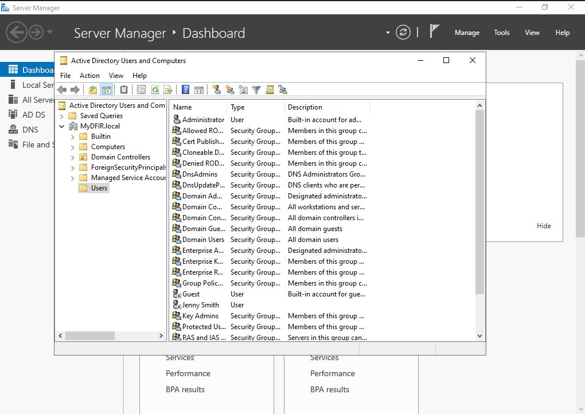

---

## 🧹 9. Post-Lab Cleanup & Security Hygiene
Upon completing the project and capturing all verification artifacts, proper operational security and cleanup procedures were executed:
* Terminated the Flask webhook listener and closed all active `pinggy.io` reverse tunnels on Kali Linux.
* Revoked/regenerated OAuth tokens and webhook URLs exposed during testing.
* Removed any temporary capabilities (such as OpenSSH Server) from `ADDC01`.
* Re-enabled the test user account via PowerShell (`Enable-ADAccount -Identity JSmith`) and gracefully powered down the VirtualBox environment.

---

## 💡 10. Key Takeaways & Skills Demonstrated
* **SIEM Administration & Detection Engineering:** Deployed Splunk Enterprise on Linux, configured Universal Forwarders across Windows Server/AD endpoints, and wrote SPL queries utilizing Windows Security Event IDs (`4624`, Logon Types `7` & `10`).
* **SOAR Playbook Design:** Built multi-stage automated workflows in Shuffle integrating Webhooks, Slack API bots, and Human-in-the-Loop email approvals.
* **Advanced Troubleshooting & Protocol Analysis:** Diagnosed complex cross-layer issues using `netcat`, `ldapsearch`, and execution log inspection—identifying OpenSSL 3.0 `MD4`/`NTLM` cryptographic incompatibilities in cloud SOAR environments.
* **Custom Security Tooling (Python):** Developed a lightweight Flask + `ldap3` REST API middleware to translate SOAR HTTP webhooks into LDAP Simple Bind modifications (`userAccountControl` bitwise manipulation).
